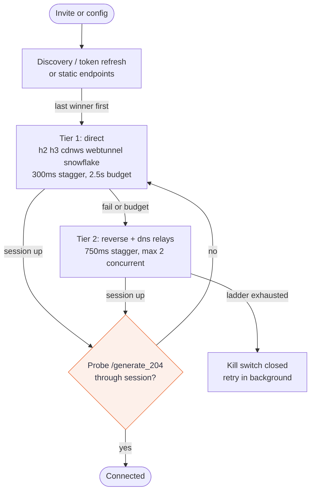
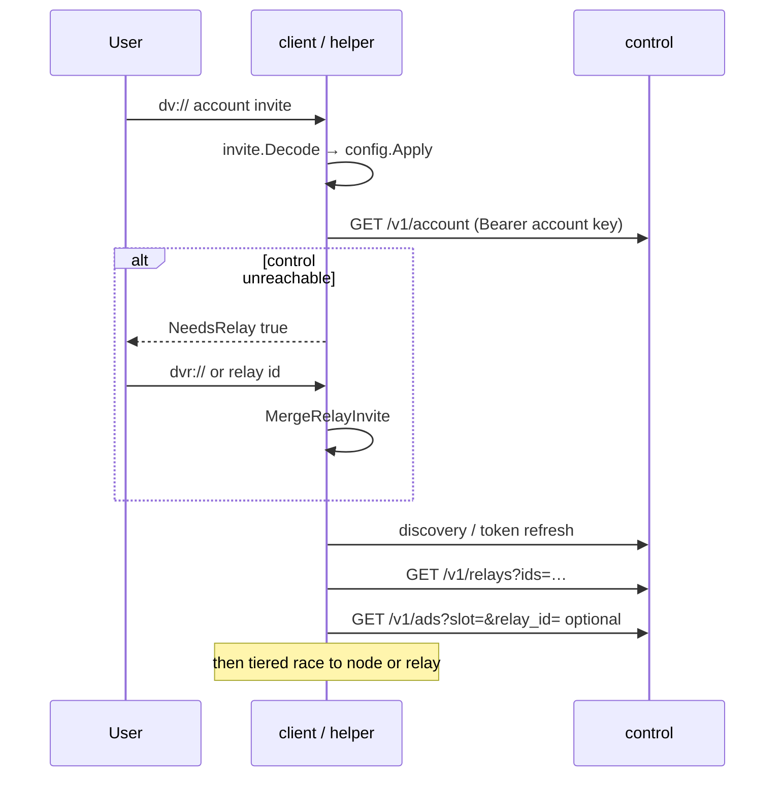
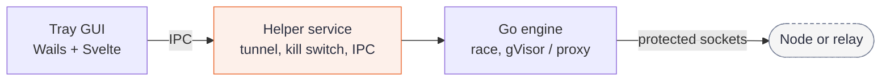

<picture>
  <source media="(prefers-color-scheme: dark)" srcset=".github/readme-header-dark.svg">
  
</picture>

# dotvpn-client


The client of [Dot VPN](https://github.com/payam-foundation/dotvpn-wire#related-repositories): a Go library and the `dotvpn` command for Linux, macOS and Windows. It runs a local SOCKS5/HTTP proxy or a full-device tunnel, and walks a fallback ladder of carriers until one works under the network you are on.

## Status

Beta. The kill switch has unit tests on every OS and an end-to-end test on Linux only. macOS pf and Windows firewall rules are covered by rule-generation tests, not yet by real-host runs. iOS is out of scope.

## How it connects

Config comes from a `dv://` invite (or saved YAML). With a control URL the engine refreshes a signed server list and short-lived tokens; otherwise it uses static endpoints. Carriers race in **two tiers** (happy eyeballs within each tier). The last winner is preferred on the next start via `state.json`. A session only counts as connected after a probe (`GET /generate_204` to `probe_target`, default `connectivitycheck.gstatic.com:80`) succeeds through it. With the kill switch on, the device stays closed while the ladder searches or has failed. Carrier kinds are defined in [dotvpn-wire](https://github.com/payam-foundation/dotvpn-wire#carriers). [dotvpn-android](https://github.com/payam-foundation/dotvpn-android) binds the same engine through this repo's `mobile/` package.



Which endpoints exist comes from the invite and control's signed list (`ExpandReverse` for hidden nodes). `use_relays` gates reverse/dns; opted-in relay ids in `relays` are sent on discovery/token refresh.

### Invites and control APIs



- **`dv://`:** account, control URL, trusted keys, endpoints, optional bootstrap. Tunnel enabled after import.
- **`dvr://`:** control-signed relay invite; merges expanded relay endpoints so a blocked-path client can cold-start. Verify before dialing ([wire invites](https://github.com/payam-foundation/dotvpn-wire#tokens-and-invites)).
- **401 on account:** logout clears account/control/endpoints/relays; carrier and routing prefs stay.

### Desktop helper

The tray GUI is unprivileged. A root-owned helper holds the tunnel and kill switch over IPC, so quitting the window does not drop the session and a GUI crash does not leak. The same helper is driven by `dotvpn import` / `connect` / `status`.



## Install

Download the archive for your platform from the [releases page](https://github.com/payam-foundation/dotvpn-client/releases), [verify it](#verify-a-release), and put `dotvpn` on your `PATH`. Or build from source:

```sh
go install github.com/payam-foundation/dotvpn-client/cmd/dotvpn@vX.Y.Z
```

## Desktop app

A tray app for macOS, Linux and Windows (`desktop/`, Wails + Svelte). It is unprivileged and talks to a helper service that holds the tunnel and kill switch, so quitting the app does not drop the tunnel and a GUI crash does not leak. Nav is **Home | Account | Relay | Settings**. Home uses a centered on/off switch (ink, never lime), node picker, kill switch, and via-relay / exit-IP when known. Account and Relay call `GET /v1/account` and `GET /v1/relays` through the helper; Settings covers App, Connection (protocols + bypass), DNS presets, Report a problem (an encrypted file to email), and optional crash reports (off by default; Sentry `dv-desktop`).

1. Open the app and choose **Set up Dot VPN**. The helper is embedded in the app; this copies it to a root-owned system path and registers the service, with one OS admin prompt. Nothing else to download.
2. Paste an invite from Account (or first-run), or click a `dv://` link.
3. Connect from Home or the tray menu. Closing the window hides it to the tray.

The same helper is driven from a terminal:

```sh
sudo dotvpn service install                   # once; also `uninstall` and `status`
dotvpn import 'dv://...'
dotvpn connect && dotvpn status
dotvpn report --out FILE                   # encrypted report to email to report@dotvpn.org
dotvpn disconnect
```

Build the app (needs CGO; GTK 4 + WebKitGTK 6 on Linux, WebView2 on Windows):

```sh
cd desktop/frontend && pnpm install && pnpm build
cd .. && GOWORK=off go generate ./... && GOWORK=off CGO_ENABLED=1 go build -o dotvpn-desktop .
```

Run it locally from source (no install, notifications off on macOS). Commands assume you are in `desktop/` (not the client repo root):

```sh
cd frontend && pnpm install && pnpm build && cd ..
GOWORK=off go generate .          # embeds helper/; must succeed before run
GOWORK=off CGO_ENABLED=1 go run .
```

`go generate` builds the helper against a parent `go.work` when present (needed for local wire). If generate prints `unknown field Relays`, fix the workspace or wire pin first — otherwise the app still embeds an old helper and IPC will mismatch. After a version bump, use **Update helper** in the window once (admin prompt) so the root-owned service matches the embed.

Without the helper the window shows setup. To try the UI without any helper, run `pnpm exec vite build --mode mock && pnpm exec vite preview --outDir dist-mock --port 4173` in `frontend/` (mock data, opens at `http://localhost:4173`). Stop the app with `pkill dotvpn-desktop` or Ctrl-C.

On macOS, notifications work only from a signed `.app` bundle. A bare binary runs without them. On GNOME, tray icons need the AppIndicator extension; without it the window stays open and Settings says so. The GUI is unprivileged; a service installed once (launchd, systemd, Windows service) owns the tunnel and kill switch, so both outlive the window.

### Manual verification (Windows and Linux)

CI builds the GUI on all three systems and the lab covers Linux full tunnel through the helper. Real-host checks below are not automated. Run them on a machine you can recover, with a node you control.

1. `dotvpn service install` shows one prompt (UAC or pkexec). `dotvpn service status` says running.
2. Import an invite, connect with kill switch on. `curl https://ifconfig.me` shows the node address. A target reachable only through the node is reachable.
3. Stop the node. Everything outside the tunnel stays blocked (IPv4, IPv6, DNS, STUN). Restart the node and it reconnects.
4. Kill the app, then the helper (`taskkill /f` or `kill -9`). Restart the helper. Normal connectivity returns with no manual step; `dotvpn -unblock` also works.
5. Disconnect. Routes, DNS and firewall rules match what they were before (`route print` or `ip route`, `ipconfig /all` or `resolvectl`, `netsh advfirewall` or `nft list ruleset`).
6. Window close hides to the tray, tray menu shows state and Connect or Disconnect, Quit leaves the tunnel up. Switch the language to Persian: layout is RTL and digits are Persian.
7. Linux only: on GNOME without AppIndicator the window stays open and Settings explains why. With it, the tray icon appears.
8. Windows only: wintun loads, the notification-area icon appears, toast shows on fallback.

## Quick start

Get an invite (`dv://...`) from the operator of a [dotvpn-core](https://github.com/payam-foundation/dotvpn-core) server.

```sh
dotvpn -invite 'dv://...'                 # saves the config, then runs a SOCKS5 and HTTP proxy on 127.0.0.1:1080
dotvpn                                        # later runs use the saved config
sudo dotvpn -tun -kill-switch                 # full tunnel with kill switch (Administrator on Windows)
sudo dotvpn -unblock                          # remove kill-switch rules left behind by a crash
dotvpn version
```

Point an application at `socks5h://127.0.0.1:1080` (or use it as an HTTP proxy). `-v` enables debug logs. `-config` overrides the config path (`$DOTVPN_CONFIG`, else the user config directory).

| Mode | Flags | Notes |
|---|---|---|
| Proxy | none | Loopback only. A non-loopback `-listen` is refused unless `listen_auth` is set. |
| Full tunnel | `-tun` | Needs root or Administrator. A user-space network stack (gVisor) terminates TCP and UDP from the TUN device. |
| Full tunnel and kill switch | `-kill-switch` | Implies `-tun`. Blocks everything outside the tunnel. |

## Leak guards

In full-tunnel mode the client defends against the usual leaks. Each guard is a separate module with its own tests.

- **Kill switch.** Default deny. Only the tunnel endpoint may leave the device, so a dead tunnel or node cannot silently fall back to your real connection.
- **DNS.** Queries are answered by a local fake DNS and resolved inside the tunnel. The system resolver is not used.
- **IPv6.** Blackholed, so it cannot bypass the tunnel.
- **STUN and WebRTC.** Non-DNS UDP is dropped unless the server advertises UDP over the tunnel (`udp=1`), in which case it rides the tunnel.
- **Bypass sockets.** The client's own sockets are pinned to the physical interface so the tunnel cannot capture itself.

If the client crashes with the kill switch on, run `dotvpn -unblock` before anything else.

## Configuration

The config is YAML, written by `-invite`. These keys matter most.

| Key | Effect |
|---|---|
| `listen` | Local proxy address. Default `127.0.0.1:1080`. |
| `listen_auth` / `listen_auth_file` | `user:pass` for the local proxy. Required for a non-loopback `listen`. |
| `ech` (endpoint parameter) | `auto` tries ECH and falls back to GREASE; `require` fails closed; or a base64 ECHConfigList. Configs are fetched over DNS-over-HTTPS to pinned resolver IPs. |
| `probe_target` | `host:port` fetched through each new session (`/generate_204`) before it counts as connected. `off` disables. |
| `state_file` | Persists the last good endpoint, no secrets. `off` disables. |
| `upstream_proxy` | `socks5://` or `http://` URL for TCP carriers. HTTP/3 is skipped. |
| `routing.direct_domains`, `direct_cidrs`, `direct_geoip`, `direct_geosite` | Destinations that bypass the tunnel (split routing). |

## Security model

| Resists | Does not resist |
|---|---|
| Leaks when the tunnel or node dies, on Linux (tested end to end). | Malware or an application that talks to the network before the client starts. |
| IPv6, DNS and STUN/WebRTC leaks in full-tunnel mode. | Anything you route around the tunnel with `routing.direct_*`. |
| Blocking of any single carrier (the ladder moves on). | A censor that blocks every carrier you have endpoints for. |
| Local-proxy abuse: loopback-only unless authenticated. | Device compromise, or an operator who logs the node side. |

The [lab](https://github.com/payam-foundation/dotvpn-lab#what-a-green-result-means) tests mechanisms against documented censor behaviour. It does not show that the client works in any given country.

## Verify a release

```sh
cosign verify-blob --bundle checksums.txt.sigstore.json \
  --certificate-identity-regexp 'https://github.com/payam-foundation/dotvpn-client/' \
  --certificate-oidc-issuer https://token.actions.githubusercontent.com checksums.txt
sha256sum -c --ignore-missing checksums.txt
```

## Upgrade and rollback

Replace the binary. The config format is additive, so rolling back to the previous release binary is safe. If the client crashed with the kill switch on, run `dotvpn -unblock` first to restore routing and firewall rules. A wire major bump needs a matching server: upgrade or roll back core, relay and client together.

## Use as a library

The `client` package is the engine used by the CLI. The `mobile` package is the gomobile surface that [dotvpn-android](https://github.com/payam-foundation/dotvpn-android) wraps.

## Development

Requires the Go version in `go.mod`.

```sh
go build ./... && go vet ./...
go test -race -count=1 ./...
GOOS=android GOARCH=arm64 go vet ./...   # mobile build tags
```

`go.mod` pins an exact `dotvpn-wire` tag. For side-by-side work with a sibling checkout use an untracked `go.work` in the parent directory (see CONTRIBUTING.md). CI tests against the pinned wire tag and wire `main`. TUN, kill switch and censor behaviour are exercised end to end by [dotvpn-lab](https://github.com/payam-foundation/dotvpn-lab). The client never imports core or relay. TCP terminates in a user-space gVisor stack fed by the TUN device, so one implementation serves macOS, Linux and Windows.

Read [CONTRIBUTING.md](CONTRIBUTING.md) first. Report vulnerabilities as described in [SECURITY.md](SECURITY.md).

## Related repositories

| Repository | Role |
|---|---|
| [dotvpn-wire](https://github.com/payam-foundation/dotvpn-wire) | Shared wire protocol |
| [dotvpn-core](https://github.com/payam-foundation/dotvpn-core) | Server: node, control plane |
| [dotvpn-relay](https://github.com/payam-foundation/dotvpn-relay) | In-country stealth hop |
| [dotvpn-android](https://github.com/payam-foundation/dotvpn-android) | Android app |
| [dotvpn-lab](https://github.com/payam-foundation/dotvpn-lab) | Censorship lab and black-box tests |

## License

[GNU AGPL-3.0-only](LICENSE). If you run a modified version as a network service you must offer its source to the users of that service.
