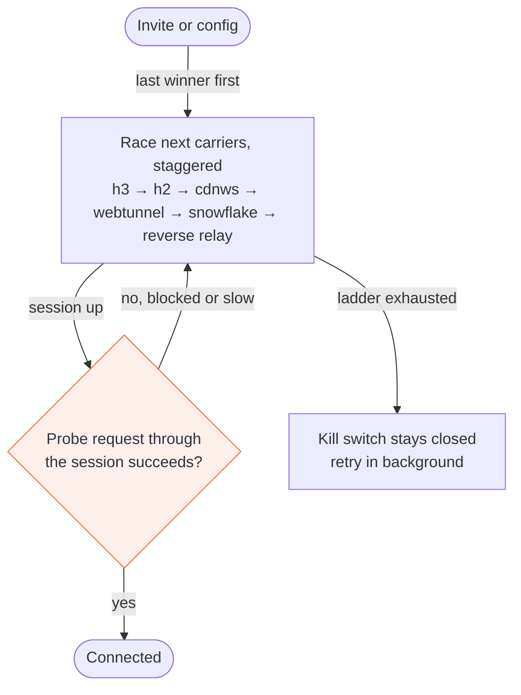

# dotvpn-client

[](https://github.com/payam-foundation/dotvpn-client/actions/workflows/ci.yml)
[](https://github.com/payam-foundation/dotvpn-client/releases)
[](#status)
[](LICENSE)

The client of [dotvpn](https://github.com/payam-foundation/dotvpn-wire#related-repositories): a Go library and the `dotvpn` command for Linux, macOS and Windows. It runs a local SOCKS5/HTTP proxy or a full-device tunnel, and walks a fallback ladder of carriers until one works under the network you are on.

## Status

Beta. The kill switch has unit tests on every OS and an end-to-end test on Linux only. macOS pf and Windows firewall rules are covered by rule-generation tests, not yet by real-host runs. iOS is out of scope.

## How it connects

Carriers race with a short stagger (happy eyeballs). The last winner goes first on the next start. A new session only counts as connected after a probe request succeeds through it. With the kill switch on, the device stays closed to everything outside the tunnel while the ladder is still searching or has failed.



The order is a default. The server list and your config decide which endpoints exist, and the engine reorders them by recent success.

## Install

Download the archive for your platform from the [releases page](https://github.com/payam-foundation/dotvpn-client/releases), [verify it](#verify-a-release), and put `dotvpn` on your `PATH`. Or build from source:

```sh
go install github.com/payam-foundation/dotvpn-client/cmd/dotvpn@vX.Y.Z
```

## Quick start

Get an invite (`dotvpn://...`) from the operator of a [dotvpn-core](https://github.com/payam-foundation/dotvpn-core) server.

```sh
dotvpn -invite 'dotvpn://...'                 # saves the config, then runs a SOCKS5 and HTTP proxy on 127.0.0.1:1080
dotvpn                                        # later runs use the saved config
sudo dotvpn -tun -kill-switch                 # full tunnel with kill switch (Administrator on Windows)
sudo dotvpn -unblock                          # remove kill-switch rules left behind by a crash
dotvpn version
```

Point an application at `socks5h://127.0.0.1:1080` (or use it as an HTTP proxy). `-v` enables debug logs. `-config` overrides the config path (`$DOTVPN_CONFIG`, else the user config directory).

| Mode | Flags | Notes |
|---|---|---|
| Proxy | none | Loopback only. A non-loopback `-listen` is refused unless `listen_auth` is set. |
| Full tunnel | `-tun` | Needs root or Administrator. A user-space network stack (gVisor) terminates TCP and UDP from the TUN device. |
| Full tunnel and kill switch | `-kill-switch` | Implies `-tun`. Blocks everything outside the tunnel. |

## Leak guards

In full-tunnel mode the client defends against the usual leaks. Each guard is a separate module with its own tests.

- **Kill switch.** Default deny. Only the tunnel endpoint may leave the device, so a dead tunnel or node cannot silently fall back to your real connection.
- **DNS.** Queries are answered by a local fake DNS and resolved inside the tunnel. The system resolver is not used.
- **IPv6.** Blackholed, so it cannot bypass the tunnel.
- **STUN and WebRTC.** Non-DNS UDP is dropped unless the server advertises UDP over the tunnel (`udp=1`, [ADR-018](https://github.com/payam-foundation/dotvpn-wire/blob/main/docs/adr/018-udp-over-tunnel-streams.md)), in which case it rides the tunnel.
- **Bypass sockets.** The client's own sockets are pinned to the physical interface so the tunnel cannot capture itself.

If the client crashes with the kill switch on, run `dotvpn -unblock` before anything else.

## Configuration

The config is YAML, written by `-invite`. These keys matter most.

| Key | Effect |
|---|---|
| `listen` | Local proxy address. Default `127.0.0.1:1080`. |
| `listen_auth` / `listen_auth_file` | `user:pass` for the local proxy. Required for a non-loopback `listen`. |
| `ech` (endpoint parameter) | `auto` tries ECH and falls back to GREASE; `require` fails closed; or a base64 ECHConfigList. See [ADR-017](https://github.com/payam-foundation/dotvpn-wire/blob/main/docs/adr/017-ech-policy.md). |
| `probe_target` | `host:port` fetched through each new session (`/generate_204`) before it counts as connected. `off` disables. |
| `state_file` | Persists the last good endpoint, no secrets. `off` disables. |
| `upstream_proxy` | `socks5://` or `http://` URL for TCP carriers. HTTP/3 is skipped. |
| `routing.direct_domains`, `direct_cidrs`, `direct_geoip`, `direct_geosite` | Destinations that bypass the tunnel (split routing). |

## Security model

| Resists | Does not resist |
|---|---|
| Leaks when the tunnel or node dies, on Linux (tested end to end). | Malware or an application that talks to the network before the client starts. |
| IPv6, DNS and STUN/WebRTC leaks in full-tunnel mode. | Anything you route around the tunnel with `routing.direct_*`. |
| Blocking of any single carrier (the ladder moves on). | A censor that blocks every carrier you have endpoints for. |
| Local-proxy abuse: loopback-only unless authenticated. | Device compromise, or an operator who logs the node side. |

The [lab](https://github.com/payam-foundation/dotvpn-lab#what-a-green-result-means) tests mechanisms against documented censor behaviour. It does not show that the client works in any given country.

## Verify a release

```sh
cosign verify-blob --bundle checksums.txt.sigstore.json \
  --certificate-identity-regexp 'https://github.com/payam-foundation/dotvpn-client/' \
  --certificate-oidc-issuer https://token.actions.githubusercontent.com checksums.txt
sha256sum -c --ignore-missing checksums.txt
```

## Upgrade and rollback

Replace the binary. The config format is additive, so rolling back to the previous release binary is safe. If the client crashed with the kill switch on, run `dotvpn -unblock` first to restore routing and firewall rules. A wire major bump needs a matching server: upgrade or roll back core, relay and client together.

## Use as a library

The `client` package is the engine used by the CLI. The `mobile` package is the gomobile surface that [dotvpn-android](https://github.com/payam-foundation/dotvpn-android) wraps.

## Development

Requires the Go version in `go.mod`.

```sh
go build ./... && go vet ./...
go test -race -count=1 ./...
GOOS=android GOARCH=arm64 go vet ./...   # mobile build tags
```

`go.mod` carries a `replace` to `../dotvpn-wire` for side-by-side work with a sibling checkout. CI drops it and tests against the pinned wire tag and wire `main`. TUN, kill switch and censor behaviour are exercised end to end by [dotvpn-lab](https://github.com/payam-foundation/dotvpn-lab). The client never imports core or relay. Design: [ADR-009](docs/adr/009-gvisor-netstack.md).

Read [CONTRIBUTING.md](CONTRIBUTING.md) first. Report vulnerabilities as described in [SECURITY.md](SECURITY.md).

## Related repositories

| Repository | Role |
|---|---|
| [dotvpn-wire](https://github.com/payam-foundation/dotvpn-wire) | Shared wire protocol |
| [dotvpn-core](https://github.com/payam-foundation/dotvpn-core) | Server: node, control plane |
| [dotvpn-relay](https://github.com/payam-foundation/dotvpn-relay) | In-country stealth hop |
| [dotvpn-android](https://github.com/payam-foundation/dotvpn-android) | Android app |
| [dotvpn-lab](https://github.com/payam-foundation/dotvpn-lab) | Censorship lab, architecture and ADR index |

## License

[PolyForm Noncommercial License 1.0.0](LICENSE). Source-available, not open source: personal, research, educational and non-profit use is permitted; commercial use needs a separate licence from Payam Foundation.
